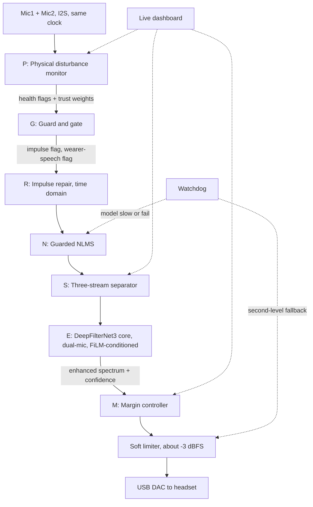

# **VaaniShield**

### **A self-monitoring, dual-microphone neural denoiser for defence communication, designed to run in real time on a Raspberry Pi**

**Smart India Hackathon 2026** | Problem Statement **SIH26052** | Category: **Hardware** | Theme: **Miscellaneous**

> **PROJECT STATUS: DESIGN STAGE.**
> This repository documents the **full design**, **dataset specification** and **evaluation plan**. Items are labelled **Implemented**, **In progress** or **Planned** in the [Status table](#11-project-status). **Nothing in this README is a measured result unless it says so. Targets are targets, not achievements.**

---

## **Table of contents**

1. [The problem](#1-the-problem)
2. [Why classical noise cancellation fails here](#2-why-classical-noise-cancellation-fails-here)
3. [Our idea in one paragraph](#3-our-idea-in-one-paragraph)
4. [System architecture](#4-system-architecture)
5. [Block-by-block explainer](#5-block-by-block-explainer)
6. [Dataset pipeline](#6-dataset-pipeline)
7. [The neural model and training](#7-the-neural-model-and-training)
8. [Hardware prototype](#8-hardware-prototype)
9. [Safety design](#9-safety-design)
10. [Evaluation plan](#10-evaluation-plan)
11. [Project status](#11-project-status)
12. [What we claim and what we do not](#12-what-we-claim-and-what-we-do-not)
13. [Known limitations and risks](#13-known-limitations-and-risks)
14. [Proposed repository layout](#14-proposed-repository-layout)
15. [Getting started (planned)](#15-getting-started-planned)
16. [Impact and future scope](#16-impact-and-future-scope)
17. [Team](#17-team)
18. [References](#18-references)
19. [License and disclaimer](#19-license-and-disclaimer)

---

## **1. The problem**

**PS SIH26052:** develop an **AI/ML-enabled adaptive noise cancellation (ANC) system** that suppresses **stationary**, **non-stationary** and **impulsive** defence noises while maintaining **high speech intelligibility** and **real-time performance on embedded hardware**.

In practice, a soldier's radio or headset audio is buried under:

| Noise type | Examples | Why it is hard |
|---|---|---|
| **Stationary** | Engine hum, wind, rotor drone | Steady, but often **as loud as speech** |
| **Non-stationary** | Vehicle passing, crowd, machinery changes | Statistics change **faster than simple filters adapt** |
| **Impulsive** | Gunshots, artillery, blasts | Last only **a few milliseconds** but are **extremely loud** |

**Misheard commands are a mission risk, and very loud impulses are also a hearing-safety risk for the listener.**

**Our interpretation of the PS:** we treat this as noise cancellation on the **communication path** (microphone to headset audio), i.e. **speech enhancement**. **We do not attempt physical anti-noise inside the earcup in this phase** (see [Future scope](#16-impact-and-future-scope)).

## **2. Why classical noise cancellation fails here**

- **Spectral subtraction and Wiener filtering** assume the noise is roughly **stationary** so it can be estimated in speech pauses. Engines and wind fit this; **gunshots and changing vehicle noise do not**.
- **LMS/NLMS adaptive filters** need a **reference signal** correlated with the noise and can **diverge** or **cancel the wearer's own voice** if they keep adapting during speech or impulses.
- **Frame-based neural models** typically work on **20-32 ms STFT frames**. **A gunshot lasts roughly 1-5 ms, so it is shorter than one frame** and gets smeared across the frame instead of being removed cleanly.
- **Single-model systems fail silently.** If a microphone is blocked or wind-blasted, or the model is too slow, most systems just produce **bad or no audio**.

**Our design attacks each of these failure modes with a specific block** (Section 5).

## **3. Our idea in one paragraph**

VaaniShield combines a **pretrained open-source neural denoiser (DeepFilterNet3)**, **fine-tuned for defence-like noise**, with a set of **small, mostly classical blocks around it**: a **guard** that detects gunshots and wearer speech, a **time-domain repair** step for impulses, a **guarded adaptive filter**, a **three-stream separator**, a **per-frame confidence controller**, a **microphone-health monitor**, and a **limiter plus watchdog**. The neural model does the heavy lifting; the surrounding blocks handle the cases where a neural model alone is known to be weak, and **make the system degrade safely instead of going silent**.

> **The base model is DeepFilterNet3. Our contribution is the surrounding pipeline, the dataset design, the dual-microphone conditioning and the evaluation plan.** Every additional block is a **hypothesis** that our ablation study will test; **blocks that do not show a measured gain will be dropped**, and optional blocks are built only if time allows.

## **4. System architecture**



> **Core path:** **G, N, E, limiter and watchdog.** Blocks **P, R, S and M** in the diagram are **optional extensions** (see Section 5).

### **Signal flow in words**

1. Two **I2S MEMS microphones** capture audio, **sample-synchronised because they share one clock**.
2. The **disturbance monitor** checks raw microphone frames for blocked, dead, clipped, wind-blasted or touched microphones, **without using any neural network**.
3. The **guard** flags **impulses (gunshots)** and **wearer speech**.
4. **Impulse repair** blanks the few milliseconds of an impulse and refills them from neighbouring samples.
5. A **guarded NLMS** removes noise that both microphones hear, and is **frozen during impulses, speech and wind**.
6. The **separator** estimates how much of each time-frequency bin is **speech**, **continuous noise** or **impulsive noise**.
7. The **neural core** (DeepFilterNet3, extended to two microphones and conditioned on the flags and stream estimates) produces the **enhanced spectrum** and a per-bin **confidence**.
8. The **margin controller** blends the enhanced output with a conservative version of the input according to confidence.
9. A **look-ahead soft limiter** protects the listener's ears before audio reaches the headset.
10. A **watchdog** switches to simpler paths if the model is too slow or fails.

### **Graceful degradation ladder**

| Level | Path | When it is used |
|---|---|---|
| **Full** | Guard, repair, NLMS, separator, DFN3 core, confidence blend, limiter | Normal operation |
| **Reduced** | NLMS + limiter | Model too slow or failed |
| **Minimal** | Pass-through + limiter | Everything else failed |

## **5. Block-by-block explainer**

Each block lists **what it does**, **how**, and **which failure it addresses**.

**Core vs optional.** The **core system** is the **guard (G)**, **guarded NLMS (N)**, the **neural core (E)** and the **limiter and watchdog**. **These cover the PS requirements.** The **disturbance monitor (P)**, **impulse repair (R)**, **three-stream separator (S)**, **confidence controller (M)** and **dashboard** are **optional extensions**: they are designed and documented here, but **they are built and reported only if time allows.**

### **5.1 P: Physical disturbance monitor (no neural network)** *(optional)*

- **Input:** raw microphone frames.
- **Method:** simple, explainable signal checks.
  - **Blocked or dead mic:** energy collapse in one channel.
  - **Wind:** strong low-frequency energy with low inter-mic coherence (wind is uncorrelated between mics).
  - **Clipping:** samples running at full scale.
  - **Touch or handling thump:** low-frequency burst in one microphone only.
  - **Dropout or clock issue:** missing or repeated blocks.
- **Output:** a **health flag** and a **trust weight** per microphone.
- **Why it exists:** **a neural model cannot tell that its own input is broken.** This block is deliberately independent of the model, so it still works when the model is wrong.
- **Metric (if built):** detection rate and false-alarm rate on injected faults (not SNR).
- **Assumption:** we interpret "physical disturbance" as **microphone-level faults**. Locating a gunshot's direction from inter-mic delay is a different block and would be coarse with two microphones a few centimetres apart.

### **5.2 G: Guard and gate** *(core)*

- **Impulse flag:** a frame-energy jump of roughly **15 dB** above a running median (threshold to be tuned).
- **Wearer-speech flag:** high **Mic1/Mic2 energy ratio**, because Mic1 is near the mouth and Mic2 faces away.
- **Purpose:** **stops the adaptive filter from blowing up on gunshots or cancelling the wearer's own voice**, and tells the neural model when an impulse is present.

### **5.3 R: Impulse repair (time domain)** *(optional)*

- **Problem:** a gunshot (about **1-5 ms**) is shorter than one **20 ms STFT frame**, so a frame-based model cannot localise it.
- **Method:** blank about **2-5 ms** around the detected impulse and fill the gap by **LPC interpolation** from neighbouring samples.
- **Result:** a **click-free signal** that the model then processes.
- **Known limit:** muzzle-blast ringing can outlast the click; the neural model handles that tail. **If built, we will report impulsive-noise results with and without this block.**

### **5.4 N: Guarded NLMS** *(core)*

- A **normalised LMS adaptive filter** using **Mic2 as a noise reference** for Mic1.
- **Guard rule:** step size **`mu = 0`** during impulses, wearer speech and wind.
- **Kept in the final system only if the ablation shows a gain.**

### **5.5 S: Three-stream separator** *(optional)*

- Estimates, per time-frequency bin, soft masks for **speech**, **continuous noise** and **impulsive noise**.
- **Tier 1 (rule-based, no training):** continuous = minimum-statistics stationary noise estimate; impulsive = transient-detector residual; speech = Mic1/Mic2 ratio plus voice activity detection.
- **Tier 2 (learned):** a small head trained with the exact **three-layer labels** from the dataset (Section 6).
- **Why it exists:** a gunshot landing on a syllable should be removed **without damaging the speech underneath it**, which requires knowing which stream a bin belongs to.

### **5.6 E: Neural core (DeepFilterNet3, dual-mic, FiLM-conditioned)** *(core)*

- **Base:** pretrained **DeepFilterNet3** (ERB-band gains plus deep-filter taps).
- **Extensions:** second microphone as side information (complex STFT plus inter-mic ratio and phase), and **FiLM** conditioning from the guard flags and separator streams.
- **Speech-preservation rule:** where speech probability is high, the per-bin attenuation is **capped** (starting point **12 dB**, to be tuned on validation data), **trading a little residual noise for intelligibility.**
- **Output:** enhanced spectrum plus per-bin **confidence**.

### **5.7 M: Margin controller (confidence blend)** *(optional)*

`out = c * enhanced + (1 - c) * conservative`

- `conservative` is a **mild-gain version of Mic1**.
- Confidence `c` is combined from three sources (minimum or weighted average):
  1. A **learned head** trained on the known error `|enhanced - clean|` (possible because the data is synthetic).
  2. **Agreement** between the model's gain and a classical noise-estimate gain.
  3. A **quality-estimate gate**: if predicted output quality is below the input's, use pass-through.
- **Wording:** this is a *confidence estimate*, **not a guarantee**, until we show calibration (see limitations).

### **5.8 Limiter and watchdog** *(core)*

- **Look-ahead soft limiter** at about **-3 dBFS** protects the listener from peaks.
- **Watchdog** monitors processing time per frame and model health, and steps down the degradation ladder in Section 4.

### **5.9 Live dashboard** *(optional)*

A small view of the **stream mix**, **confidence**, **microphone health**, **real-time factor** and **latency**. **It is a debugging and demo aid, not a claim of performance.**

## **6. Dataset pipeline**

We build every training example as **three separate layers**, so the ideal target for each stream is known exactly:

```
mic = speech + g_bg * background(continuous) + g_ev * event(gunshot / blast)
saved: speech, background, event     (labels for the separator)
```

| Parameter | Planned range |
|---|---|
| **SNR** | **-5 to 15 dB** |
| **Events per clip** | 1 to 3, some deliberately on syllables |
| **Reverb** | Simulated room impulse responses (pyroomacoustics) |
| **Two-mic simulation** | Mic1 near mouth, Mic2 facing away, with speech leakage into Mic2 at about -15 to -25 dB |
| **Hardware effects** | Clipping, radio band-limit, reference-mic dropout |
| **Fault simulation** | Blocked-mic and wind/thump cases, used only to test block P |

**Data sources:** public speech corpora (e.g. **LibriSpeech**) and public noise sets, plus **our own recordings** from the prototype microphones. Public sets contain few genuinely defence-specific clips, so **we hold out noise *types* for testing** and design the pipeline to accept **real defence noise recordings** later without changes.

**Consistency rule:** whatever runs live before the model (repair, NLMS) **must also run inside the data pipeline**. Otherwise the model trains on data that differs from what it sees in deployment. If a block is not applied in training, it is kept only as a separate output path.

## **7. The neural model and training**

- **Approach:** **fine-tune DeepFilterNet3, do not train from scratch.**
- **Staged plan:**
  1. **Tier 0:** pretrained DFN3 + limiter + watchdog, running live. **This must work first.**
  2. **Single-channel fine-tune** on our data (Plan B).
  3. **Dual-mic input** and impulse/noise-type conditioning (Plan A), if time allows.
- **Losses (planned):** **SI-SNR**, **L1/L2 spectral losses** and a **perceptual loss**, with extra weight on frames containing impulses.
- **Deployment:** export to **ONNX** and quantise to **int8** for the Raspberry Pi. If measured real-time factor is too high, a lighter model (e.g. **GTCRN**) is the fallback.
- **Licence of the base model:** DeepFilterNet3 is released under permissive licences (MIT/Apache-2.0). Confirm against the repository before redistributing weights.

## **8. Hardware prototype**

| Item | Choice |
|---|---|
| **Compute** | **Raspberry Pi 5**, with heatsink, fan and adequate power supply |
| **Microphones** | **2x INMP441** I2S MEMS on one I2S bus (same clock, so sample-synchronised) |
| **Playback** | USB DAC + headset |
| **Backup** | ReSpeaker 2-Mic HAT, spare SD card image |
| **Optional** | Jetson (TensorRT) comparison, since the PS mentions Jetson-class hardware "or similar" |

**Wiring summary (INMP441 to Raspberry Pi I2S):** VDD to **3.3 V**, GND to **GND**, SCK to **GPIO18**, WS to **GPIO19**, SD to **GPIO20**. **Mic1** (near the mouth) has its L/R pin to **GND**; **Mic2** (facing away) has L/R to **3.3 V**, so they share the bus as left and right channels.

**Real-time budget:** **the CPU budget on the Pi is unmeasured.** Measuring **real-time factor** and **end-to-end latency** is the first milestone, and it decides which model and which optional blocks we actually run.

## **9. Safety design**

- **Ear safety:** look-ahead soft limiter at about **-3 dBFS**.
- **Fail-safe audio:** the watchdog **degrades the pipeline rather than muting it**.
- **Safe testing:** noise and gunshot recordings are played from a speaker at safe levels. **We never play real gunshot levels into a headset.**
- **No silent failure:** microphone faults and model failures are **flagged and shown on the dashboard**.

## **10. Evaluation plan**

We keep the evaluation focused on what the PS asks for: **noise suppression** across stationary, non-stationary and impulsive noise, **speech intelligibility**, and **real-time performance on embedded hardware**.

### **Metrics**

| Metric | What it tells us | PS requirement |
|---|---|---|
| **Output SI-SNR** (or SNR improvement) | Noise reduction | Suppress noise |
| **STOI** | Objective speech intelligibility | High intelligibility |
| **Real-time factor (RTF), end-to-end latency, CPU load** on the Pi | Embedded feasibility | Real-time on embedded hardware |
| **PESQ** (optional, only if it runs easily) | Perceptual speech quality | Supporting metric |

SI-SNR and STOI are reported **per noise type** (stationary, non-stationary, impulsive) and per input SNR, **using held-out noise types that were not seen in training.** The impulsive column covers the gunshot case.

### **Ablation study (core rows)**

**Values are filled in only after measurement.**

| ID | System | Output SI-SNR | STOI | RTF / latency on Pi |
|---|---|---|---|---|
| **A0** | Noisy input (baseline) | Not measured yet | Not measured yet | n/a |
| **A1** | Pretrained DFN3 | Not measured yet | Not measured yet | Not measured yet |
| **A2** | + fine-tune on defence-like noise | Not measured yet | Not measured yet | Not measured yet |
| **A3** | + reference mic (dual-mic) | Not measured yet | Not measured yet | Not measured yet |
| **A4** | + guarded NLMS (classical half of the hybrid) | Not measured yet | Not measured yet | Not measured yet |

**Any row that does not show a measured gain is dropped from the final system.**

### **Optional rows (added only if the block is actually built)**

**Impulse repair (R)**, the **three-stream separator (S)**, the **confidence controller (M)** and the **disturbance monitor (P)** are our own extensions and are not PS requirements. If they are built, each gets one extra row; if not, they stay in [Future scope](#16-impact-and-future-scope) and are not listed as results. For block P the metric would be detection and false-alarm rate on injected faults, not SNR.

### **Safety checks (simple tests, not quality scores)**

- **Limiter:** feed a loud impulse and confirm the output peak stays under the limiter ceiling.
- **Watchdog:** stop or slow the model and confirm the pipeline falls back to the simpler path **without going silent**.

### **Targets, not results**

We aim for roughly **15 dB output SNR**, **0.85 STOI** and **real-time operation on the Pi**. **These are targets. None of them has been measured or achieved.**

## **11. Project status**

| Component | Tier | Status |
|---|---|---|
| Problem analysis and architecture design | Core | **Designed** (documented here) |
| Dataset specification (three-layer mixing) | Core | **Designed** |
| Dataset generator script | Core | Planned |
| Pretrained DFN3 + limiter + watchdog live demo | Core | Planned (**first milestone**) |
| Real-time benchmark on Raspberry Pi | Core | Planned |
| Fine-tuning (single-channel, then dual-mic) | Core | Planned |
| Guard (G) and guarded NLMS (N) | Core | Planned |
| Evaluation on the 5-row core ablation | Core | Not started |
| Impulse repair (R), three-stream separator (S) | Optional | Planned, only if time allows |
| Confidence controller (M), disturbance monitor (P), dashboard | Optional | Planned, only if time allows |

## **12. What we claim and what we do not**

### **We can say**

- A **complete, PS-aligned pipeline design**: dataset, sub-band neural model, SI-SNR/L1/L2/perceptual losses, optional LMS, ONNX int8 edge deployment and a live microphone-to-headset prototype plan.
- A **safety-oriented design**: self-monitoring, graceful degradation and ear protection.
- If the optional extensions are built: to our knowledge, we have not found an open system that combines a time-domain impulse-repair stage, a three-stream separator and a confidence-gated output for defence audio. **This is a statement about what we found, not proof of novelty**, and it only applies to blocks that are actually implemented.

### **We do not say**

- **That the SNR or STOI targets (or PESQ, if measured) are achieved.**
- **That any added block improves results.** Each is a hypothesis for the ablation to test, and optional blocks that are not built make no claim at all.
- **That the base model is ours.** It is DeepFilterNet3; our additions are the blocks above.
- **That the system works in the field or is certified for operational use.**

## **13. Known limitations and risks**

| Risk | Mitigation |
|---|---|
| **Impulse repair** is wrong when muzzle-blast ringing outlasts the click | Neural model handles the tail; report results with and without repair |
| **Confidence estimate** may be over-confident (uncalibrated) | Calibration plot planned; until then call it a "confidence estimate", not a guarantee |
| **Speech-preservation cap** leaves too much residual noise | Tune the cap (dB) on validation data and report the trade-off |
| **Disturbance monitor** false alarms (e.g. loud speech flagged as wind) | Thresholds tuned on real microphones, smoothing over frames, and the model still sees the raw microphones |
| **Stacked blocks** add latency | Keep repair look-ahead to a few milliseconds, measure end-to-end latency, drop any block that costs too much |
| **Raspberry Pi CPU budget** unmeasured | Benchmark first; lighter model as fallback |
| **Simulation-to-real gap** (room response and mic behaviour differ from simulation) | EQ/RIR augmentation and a light fine-tune on real recordings |
| **Few defence-specific public noise clips** | Held-out noise types; pipeline accepts real recordings later |

## **14. Proposed repository layout**

```
.
├── README.md
├── LICENSE
├── requirements.txt
├── docs/
│   ├── architecture.md          # block diagram and signal flow
│   ├── dataset_spec.md          # three-layer mixing, SNR ranges, augmentations
│   ├── evaluation_plan.md       # metrics, protocol, ablation table
│   ├── hardware_setup.md        # wiring, I2S configuration, BOM
│   └── images/                  # diagrams and charts
├── data/
│   └── README.md                # how to obtain datasets; no large files in git
├── src/
│   ├── dataset/                 # three-layer mixer, 2-mic simulation
│   ├── blocks/                  # monitor, guard, repair, nlms, separator, controller, limiter
│   ├── model/                   # DFN3 wrapper, dual-mic and FiLM extensions
│   ├── runtime/                 # live pipeline, watchdog, dashboard
│   └── eval/                    # SI-SNR, STOI, PESQ, RTF/latency scripts
├── scripts/
│   ├── make_dataset.py
│   ├── train.py
│   ├── export_onnx.py
│   ├── benchmark_rtf.py
│   └── run_live.py
└── results/
    └── README.md                # only measured numbers, with the command that produced them
```

## **15. Getting started (planned)**

> **These commands describe the intended workflow.** Scripts are added as they are implemented; check the [Status table](#11-project-status) before running anything.

```bash
git clone https://github.com/YOUR-USERNAME/vaanishield-sih-2026.git
cd vaanishield-sih-2026
python -m venv .venv && source .venv/bin/activate
pip install -r requirements.txt

# 1) Generate synthetic three-layer data (planned)
python scripts/make_dataset.py --out data/synth --snr-min -5 --snr-max 15

# 2) Measure real-time factor on the target board (planned, first milestone)
python scripts/benchmark_rtf.py --model pretrained_dfn3

# 3) Live demo, Tier 0: pretrained model + limiter + watchdog (planned)
python scripts/run_live.py --tier 0
```

**Software stack:** **Python**, NumPy/SciPy, **PyTorch** (training), **ONNX Runtime** (edge inference), **pyroomacoustics** (simulation), **pystoi** and **pesq** (metrics), **Optuna** (hyper-parameter search).

## **16. Impact and future scope**

### **Intended impact (to be validated by the evaluation above)**

- **Infantry and vehicle/aircrew:** aims to make radio commands clearer near gunfire, engine, rotor and wind noise.
- **Disaster response and industrial sites:** aims to keep communication usable near machinery and sirens.
- **Cost and reuse:** a Pi-class device could replace custom DSP boards (exact bill of materials to be confirmed); the same pipeline accepts new noise types and real defence recordings.

### **Future scope**

- **Phase 2, physical ANC:** FxLMS-based anti-noise inside the earcup, complementing the communication-path system.
- **Real defence data:** plug in DRDO-provided noise recordings in place of public datasets.
- **Optional extensions not built in this phase (if any):** impulse repair, three-stream separator, confidence controller and disturbance monitor, each with its own ablation row.
- **Confidence calibration and distillation** into a smaller model.
- **Gunshot direction estimation** from inter-mic delay (coarse with closely spaced microphones).

## **17. Team**

| S. No. | Name | Role |
|:---:|---|---|
| 1 | Rudraksh Budhappa | Member |
| 2 | Ritesh Ranjan | Member |
| 3 | Sagar | Member |
| 4 | Isha Thakur | Member |
| 5 | Sarwat Hussian Sheik | Member |
| 6 | Janhavi Tidke | Member |

**Team name:** 6 Solvers | **Team ID:** (fill in) | **Problem Statement:** SIH26052

**Team name:** 6 Solvers | **Team ID:** (fill in) | **Problem Statement:** SIH26052

## **18. References**

1. Narain et al., review of noise-cancellation / speech enhancement work (DRDO), as studied for this project.
2. Dai Shuning, thesis on speech-preserving active noise control.
3. Westhausen and Meyer, **DTLN** (dual-signal transformation LSTM network) and its echo-cancellation variant.
4. Schröter et al., **DeepFilterNet** family of speech-enhancement models (repository and papers).
5. **GTCRN**, a lightweight speech-enhancement model (fallback candidate).
6. **pyroomacoustics** documentation (room and microphone simulation).
7. **pystoi** and **pesq** packages (metrics).
8. **INMP441** I2S MEMS microphone datasheet.
9. Sound-level references: NIOSH / WHO / MIL-STD-1474.

## **19. License and disclaimer**

- **Code:** **MIT License** (see `LICENSE`). Third-party models and datasets keep their own licences.
- **Disclaimer:** **this is a hackathon prototype. It has not been tested or certified for operational, safety-critical or field use. Do not rely on it for hearing protection or mission communication.**
